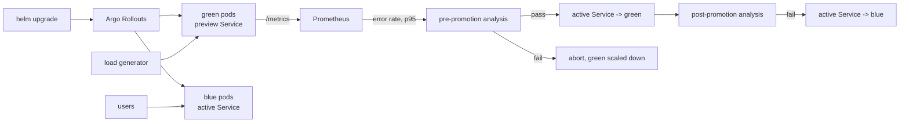

# Blue-green deployment with automated rollback

[](https://github.com/kirubakarankan/deployment_pipeline/actions/workflows/ci.yml)
[](https://github.com/kirubakarankan/deployment_pipeline/actions/workflows/e2e-blue-green.yml)

Blue-green releases with **Argo Rollouts**. The new version (green) starts next to the
live one (blue) and gets tested with **Prometheus** metrics before any user is sent
to it. Traffic only switches if the checks pass, and after the switch the same
checks keep running, so a release that breaks late is flipped back automatically.

Same app and same checks as the [canary](../canary) demo. The difference is where a
bad release gets caught: canary exposes a slice of users while it measures, blue-green
measures on a separate copy first.

## How it works



| Step | What happens |
|---|---|
| 1 | `helm upgrade` changes the pod template, and Argo Rollouts starts a second ReplicaSet (2 pods) behind the `-preview` Service |
| 2 | A load generator sends traffic to `-preview` only, and the pre-promotion `AnalysisRun` queries Prometheus for the **green pods only** (matched on `rollouts-pod-template-hash`) |
| 3 | If error rate is under 5% and p95 latency is under 500ms, the `-active` Service switches to green and green scales to full size |
| 4 | If not, the rollout is aborted and green is scaled down. Users never left blue |
| 5 | After the switch a post-promotion `AnalysisRun` repeats the checks, and if it fails the `-active` Service goes back to blue |

The old pods stay up for 180s after the switch (`scaleDownDelaySeconds`), so rolling back
is a selector change and doesn't wait for new pods to start.

The demo service ([../canary/app/main.py](../canary/app/main.py), shared with canary)
simulates a bad release with `FAULT_ERROR_RATE` and `FAULT_LATENCY_MS`. `FAULT_AFTER_SECONDS`
delays the faults after boot, to model a release that passes its checks and breaks later.

## Repository layout

```
blue-green/
├── charts/bluegreen-app/  Helm chart: Rollout, active/preview Services, AnalysisTemplate, load generators
├── kind/                  Local cluster and Prometheus config
├── scripts/               demo-rollback.sh: ships a bad release and times it; wait-promoted.sh: used by CI
└── Makefile               Every command below (run from this folder)
```

The app image is built from [../canary/app](../canary/app), there is no second copy.
CI lives in [../.github/workflows](../.github/workflows): `ci.yml` (chart lint) and
`e2e-blue-green.yml` (all three scenarios below on a real cluster).

## Run it locally (free, about 5 minutes)

Run these from the `blue-green/` folder. You need [Podman](https://podman.io), [kind](https://kind.sigs.k8s.io), kubectl and Helm.

```bash
brew install podman kind kubectl helm
podman machine init --cpus 4 --memory 6144 && podman machine start

make up                      # kind cluster + Argo Rollouts + Prometheus + app v1
make release-good            # healthy v2: watch it get promoted
make demo                    # 30% errors: blocked before promotion
make release-good            # an aborted rollout needs a good release before the next demo
make demo SCENARIO=latency   # 800ms latency: blocked before promotion
make release-good
make demo SCENARIO=post      # breaks after the switch: rolled back
make dashboard               # Argo Rollouts UI on http://localhost:3100
make down
```

`make help` lists every target. Run `make ENGINE=docker ...` to use Docker instead.

### Error spike, caught before promotion

```
Active ReplicaSet hash: 65f4599896
Shipping broken release (30% HTTP 500s)...
[ 53s] phase=Degraded
Release blocked after 53s
Active ReplicaSet still: 65f4599896 (unchanged: yes)
bluegreen-app-5585c699c4-5-pre   Failed       46s
```

The bad version ran on 2 preview pods for under a minute and got no user traffic.
About 30s of the 53s is the analysis `initialDelay` that waits for enough data.

### Latency regression, caught before promotion

With 800ms added to every request, `p95-latency` failed at 0.975s against the 0.5s
limit, while `error-rate` stayed at 0. Each metric can stop a release on its own.

### Late failure, rolled back after promotion

Faults start 110s after the pod boots, which is later than the pre-promotion check
(about 90s), so the bad release passes it and goes live.

```
Active ReplicaSet hash: 75df99b595
Shipping broken release (50% HTTP 500s starting 110s after boot)...
[159s] phase=Degraded
Promoted after 83s, rolled back 76s later
Active ReplicaSet back on: 75df99b595
bluegreen-app-6ff88c4457-11-post   Failed       76s
```

This is the case blue-green can't prevent, only limit. Some users did get errors for
part of those 76s. Most of that time is detection (30s `initialDelay` plus a 1-minute
rate window that needs to fill with errors), not the switch back.

> **Helm 4:** the Makefile uses `--server-side=false`, because Argo Rollouts owns the
> active/preview Service selectors, and it waits on the Rollout's own `status.phase`
> because `helm --wait` can't read the status of that custom resource.

## Design choices

- **Pre and post promotion analysis**: pre keeps a bad release away from users, post
  covers failures that only show up under real traffic.
- **Fixed sample count (`count: 4`)**: unlike canary's background analysis, these runs
  have to finish on their own so the rollout can continue.
- **Separate load generator for the preview Service**: nobody else sends it traffic,
  so without it the error-rate query would have no data.
- **`failureLimit: 1`**: a run fails on its second bad measurement. A single bad
  sample doesn't stop a release, two do.
- **Costs double capacity during a release**: blue and green run side by side. That's
  the trade for testing before the switch and a fast way back.
- **Per-ReplicaSet metrics**: the queries filter on the pod-template hash, so the
  healthy pods can't hide a failing release.
