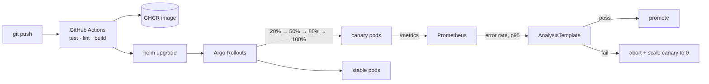

# Canary deployment with automated rollback

[](https://github.com/kirubakarankan/deployment_pipeline/actions/workflows/ci.yml)
[](https://github.com/kirubakarankan/deployment_pipeline/actions/workflows/e2e-canary.yml)

Progressive delivery on Kubernetes with **Argo Rollouts**. Each release starts as a
small canary, **Prometheus** checks its error rate and p95 latency, and a bad release
is **rolled back automatically** without a person stepping in and without downtime.

The CI pipeline proves it on every change: it creates a cluster, promotes a healthy
release, ships a broken one, and fails the build unless the broken one is rolled back.

## How it works



| Step | What happens |
|---|---|
| 1 | `helm upgrade` changes the pod template, and Argo Rollouts creates a canary ReplicaSet |
| 2 | Traffic shifts 20% → 50% → 80% → 100%, with a pause after each step |
| 3 | Throughout the rollout, a background `AnalysisRun` queries Prometheus every 15s for the **canary pods only** (matched on `rollouts-pod-template-hash`) |
| 4 | If the error rate is over 5% or p95 latency is over 500ms, the rollout is aborted, the canary scales to 0, and all traffic is back on stable |

The demo service ([app/main.py](app/main.py)) can simulate a bad release with
`FAULT_ERROR_RATE` and `FAULT_LATENCY_MS`, so no separate "broken" image is needed.

## Repository layout

```
canary/
├── app/                FastAPI service with Prometheus metrics and fault injection, plus tests and a Containerfile
├── charts/canary-app/  Helm chart: Rollout, stable/canary Services, AnalysisTemplate, load generator
├── kind/               Local cluster and Prometheus config
├── scripts/            demo-rollback.sh: ships a bad release and times the rollback
└── Makefile            Every command below (run from this folder)
```

CI lives in [../.github/workflows](../.github/workflows): `ci.yml` (tests, lint, Podman build,
push to GHCR) and `e2e-canary.yml` (the rollback test on a real cluster).

## Run it locally (free, about 5 minutes)

Run these from the `canary/` folder. You need [Podman](https://podman.io), [kind](https://kind.sigs.k8s.io), kubectl and Helm.

```bash
brew install podman kind kubectl helm
podman machine init --cpus 4 --memory 6144 && podman machine start

make up          # kind cluster + Argo Rollouts + Prometheus + app v1
make release-good  # healthy v2: watch it get promoted
make demo        # broken release: watch it roll back, with timing
make dashboard   # Argo Rollouts UI on http://localhost:3100
make down
```

`make help` lists every target. Run `make ENGINE=docker ...` to use Docker instead.

Real `make demo` run (kind on Podman, Apple Silicon):

```
Stable ReplicaSet hash: 9b5f7d5c6
Shipping broken release (30% HTTP 500s)...
[ 47s] phase=Degraded
Rollback triggered after 47s
Stable ReplicaSet still: 9b5f7d5c6 (unchanged: yes)
Canary weight now: 0%

error-rate:  Failed      last=0.294   (limit 0.05)
p95-latency: Successful  last=0.0095s (limit 0.5s)
```

The bad canary only ever got 20% of traffic, and it was gone 47s after the release
started (30s of that is the analysis `initialDelay` that waits for enough data).
The healthy v2 before it went 20% → 50% → 80% → 100% in about 2.5 minutes.

> **Helm 4:** the Makefile uses `--server-side=false`, because Argo Rollouts owns the
> stable/canary Service selectors, and it waits on the Rollout's own `status.phase`
> because `helm --wait` can't read the status of that custom resource.

## Deploying to AWS (optional)

[infra/terraform](../infra/terraform) (shared by all strategies) creates a VPC and an EKS cluster with a managed
node group. CI runs `fmt` and `validate` on it. To use it for real:

```bash
terraform -chdir=../infra/terraform init
terraform -chdir=../infra/terraform apply
$(terraform -chdir=../infra/terraform output -raw kubeconfig_command)
make addons deploy IMAGE_REPO=ghcr.io/kirubakarankan/canary-app IMAGE_TAG=latest
terraform -chdir=../infra/terraform destroy   # EKS + NAT cost money while running
```

## Design choices

- **Argo Rollouts over Flagger**: it's widely used, has a clear CRD model and a dashboard.
- **Replica-based traffic split**: no service mesh or ingress needed, so it runs anywhere.
  In production you'd add `trafficRouting` (NGINX, ALB, Istio) for exact percentages.
- **Background analysis with `failureLimit: 1`**: fails fast. One bad measurement is
  enough to roll back a canary.
- **Per-ReplicaSet metrics**: the queries filter on the pod-template hash, so the
  healthy stable pods can't hide a failing canary.
- **Podman**: rootless and daemonless containers, both locally and in CI.
